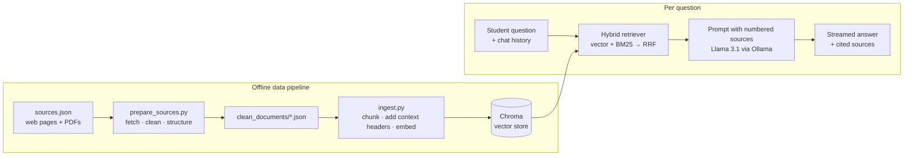

# THB StudentAssist

**A multilingual RAG chatbot that answers student questions about the Technische Hochschule Brandenburg (THB): re-registration, exams, modules, semester dates and study programs. It runs fully locally and cites its sources.**

[](https://github.com/ICHBINMINIDA/THB-StudentAssist/actions/workflows/tests.yml)


[](LICENSE)

> **Disclaimer:** This is an independent student project. It is not affiliated with or endorsed by the Technische Hochschule Brandenburg. Always verify deadlines and fees on the official THB website.

---

## Features

- **Grounded answers with citations.** Every THB-specific statement is backed by a numbered source `[1]`. Citations link to the FAQ page or to the exact page of the PDF.
- **Says "I don't know".** If the sources don't contain the answer, the bot refers students to the Studierendensekretariat or Prüfungsamt instead of guessing.
- **Multilingual.** Ask in German, English or Arabic; the answer comes in the same language, even though all sources are German.
- **Understands follow-ups.** "Wie viele ECTS hat Datenbanken?" followed by "und wie viele SWS?" still finds the right module.
- **Hybrid search.** Semantic vector search combined with BM25 keyword search, so it handles both paraphrases and exact terms (module names, "ECTS", dates).
- **Streaming chat UI.** Answers appear token by token, with Markdown rendering, dark mode, a mobile layout and suggested questions.
- **Runs locally.** Llama 3.1 via Ollama and on-device embeddings; no API keys, no data leaves the machine.

## Architecture



| Layer | Technology |
|---|---|
| LLM | Llama 3.1 (8B) served by [Ollama](https://ollama.com) |
| Embeddings | `paraphrase-multilingual-MiniLM-L12-v2` (sentence-transformers) |
| Vector store | Chroma |
| Keyword search | Own BM25 implementation, fused with Reciprocal Rank Fusion |
| Orchestration | LangChain |
| Backend | FastAPI (NDJSON streaming, rate limiting with slowapi) |
| Frontend | Plain HTML/CSS/JS, no build step |

## Getting started

### Prerequisites

- Python 3.10+
- [Ollama](https://ollama.com/download)

### 1. Install

```bash
git clone https://github.com/ICHBINMINIDA/THB-StudentAssist.git
cd THB-StudentAssist
python -m venv venv
venv\Scripts\activate          # macOS/Linux: source venv/bin/activate
pip install -r requirements.txt
ollama pull llama3.1
```

### 2. Configure

```bash
copy .env.example .env          # macOS/Linux: cp .env.example .env
```

Set `OLLAMA_BASE_URL` to wherever Ollama runs. Its default is `http://localhost:11434`.

### 3. Get the THB documents

THB documents are not redistributed in this repository. Download these PDFs from the [THB website](https://www.th-brandenburg.de) into `sources/pdf/`, using the file names listed in [`sources/metadata/sources.json`](sources/metadata/sources.json):

| File | Where to find it |
|---|---|
| `Websteite_Rahmentermine_SoSe26-SoSe28.pdf` | [Rahmentermine](https://www.th-brandenburg.de/hochschule/termine-veranstaltungen/rahmentermine/) |
| `Modulhandbuch-FBI-Praesenz-2025-Nr2_SoSe2026.pdf` | Module handbook of the Fachbereich Informatik und Medien |
| `Studiengänge.pdf` | Overview of study programs |

The web pages (FAQs, Rückmeldung) are downloaded automatically. Missing PDFs are skipped with a warning, so you can start with only some of them.

### 4. Build the knowledge base

```bash
python prepare_sources.py      # fetch + clean       -> clean_documents/
python ingest.py               # chunk + embed       -> vectorstore/
python check_db.py "Wann ist die Rückmeldung?"   # optional: inspect search results
```

### 5. Run

```bash
uvicorn app:app --reload       # open http://127.0.0.1:8000
python chatbot.py              # or chat in the terminal
```

## Adding sources

Add an entry to `sources/metadata/sources.json` (`type`: `web` or `pdf`), then rerun steps 4 and 5. `ingest.py` is incremental: it only re-embeds changed files and removes their outdated chunks first.

## How it works

Notable decisions in the retrieval pipeline:

1. **Structure-aware chunking.** FAQ pages are split into question/answer pairs, and the 480-page module handbook is grouped into one entry per module (127 modules). Each chunk starts with a context header such as `[Modulbeschreibung | Modul: Datenbanken]`, so even a chunk that only says "ECTS-Leistungspunkte: 5" knows which module it belongs to.
2. **Chunk size matches the embedding model.** The multilingual MiniLM model reads only 128 tokens. With the original 900-character chunks, about half of every chunk was never embedded. Chunks are now 450 characters.
3. **Hybrid retrieval.** Dense and BM25 rankings are merged with Reciprocal Rank Fusion. For short follow-up questions, the previous question is added as a second, higher-weighted query.
4. **Prompting.** System prompt plus chat history as real chat messages, numbered sources, an explicit answer language and a fixed fallback sentence. Only sources the model actually cites are shown. Ollama's context window is raised from its 2048-token default to 8192, so long prompts aren't silently truncated.

## API

| Method | Endpoint | Description |
|---|---|---|
| `POST` | `/ask/stream` | `{"question": "..."}` → NDJSON stream of `token` events, then `done` with sources |
| `POST` | `/ask` | Same, as a single JSON response `{answer, sources}` |
| `POST` | `/clear` | Clear the conversation history of the current session |
| `GET` | `/health` | Liveness check; also reports whether Ollama is reachable |
| `GET` | `/pdf/{file}` | Serves source PDFs so citations can link to a page |

## Configuration

All settings are environment variables (see [`.env.example`](.env.example)):

| Variable | Default | Purpose |
|---|---|---|
| `OLLAMA_BASE_URL` | `http://localhost:18080` | Ollama server |
| `OLLAMA_MODEL` | `llama3.1` | Chat model |
| `EMBEDDING_MODEL` | multilingual MiniLM | e.g. `intfloat/multilingual-e5-small` for longer inputs (re-ingest required) |
| `TOP_K` | `8` | Chunks given to the LLM |
| `MAX_HISTORY_TURNS` | `6` | Conversation turns kept per session |
| `RATE_LIMIT` | `20/minute` | Requests per IP |

## Project structure

```
├── app.py               FastAPI app (streaming, sessions, rate limiting)
├── chatbot.py           RAG pipeline: retrieval, prompting, sessions, CLI
├── retrieval.py         Hybrid retriever (vector + BM25 + RRF)
├── embeddings.py        Shared embedding model / Chroma factory
├── ingest.py            Chunking and incremental indexing
├── prepare_sources.py   Fetching and cleaning of web pages and PDFs
├── check_db.py          Inspect the index and test queries
├── config.py            Settings from environment / .env
├── templates/index.html Chat UI
├── sources/metadata/    Source definitions
└── tests/               Unit tests (pytest)
```

## Tests

```bash
pip install -r requirements-dev.txt
pytest
```

## Roadmap

- Evaluation set of real student questions with expected sources
- More sources (fees, international office, other departments)
- Stronger embedding model or a cross-encoder re-ranker
- Docker Compose setup (app + Ollama)

## License

The code is released under the [MIT License](LICENSE). THB documents and web content belong to the Technische Hochschule Brandenburg and are not included.
